# CAR GOD EYE

A **recursive** holographic vehicle teardown. One car, **338 component nodes**, every one
explained — dismantle anything, keep going deeper: engine → piston → crown → **cross-section
→ microstructure at ×500 → the crystal lattice itself**. The zoom ends at atoms, because
below that there is nothing left to engineer. Cyberpunk diagnostic-rig aesthetic.

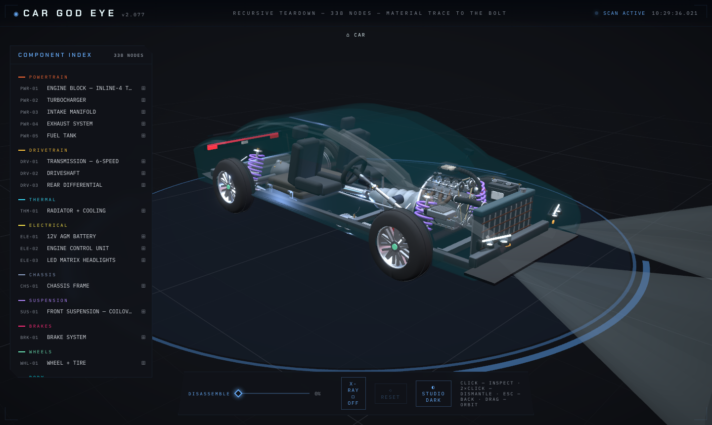
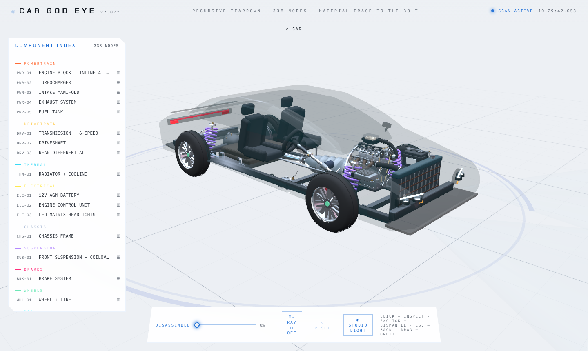

| | |
|---|---|
| 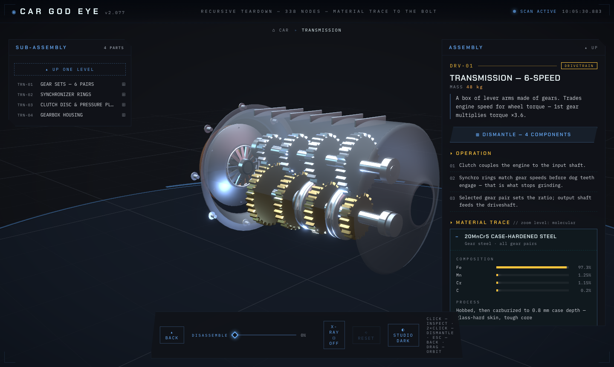 | 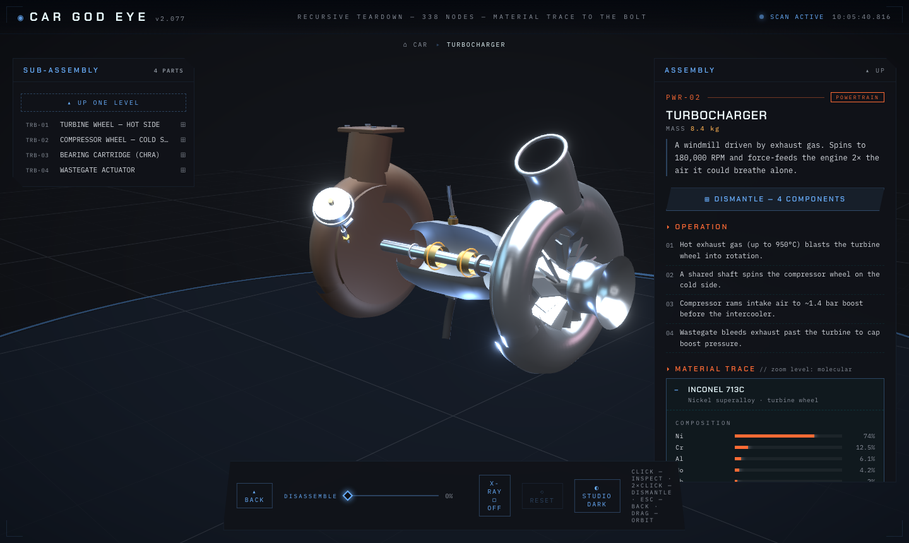 |
| 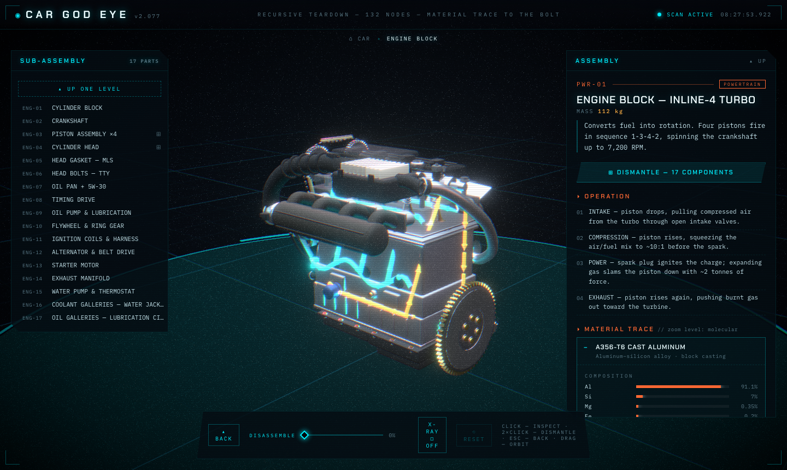 | 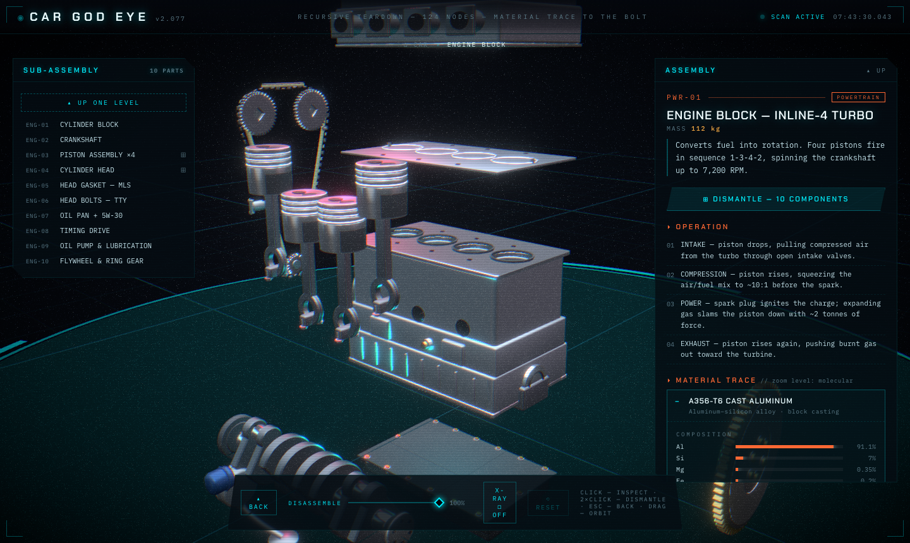 |
| 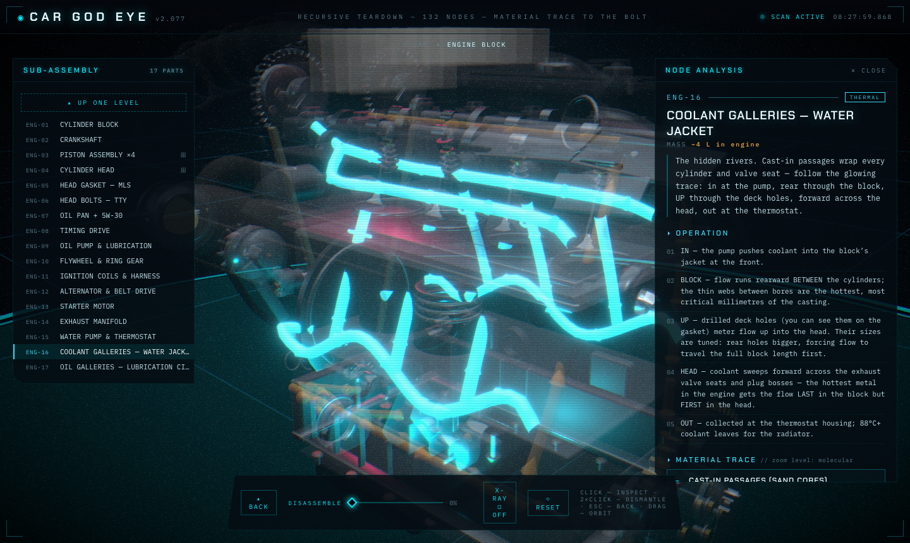 | 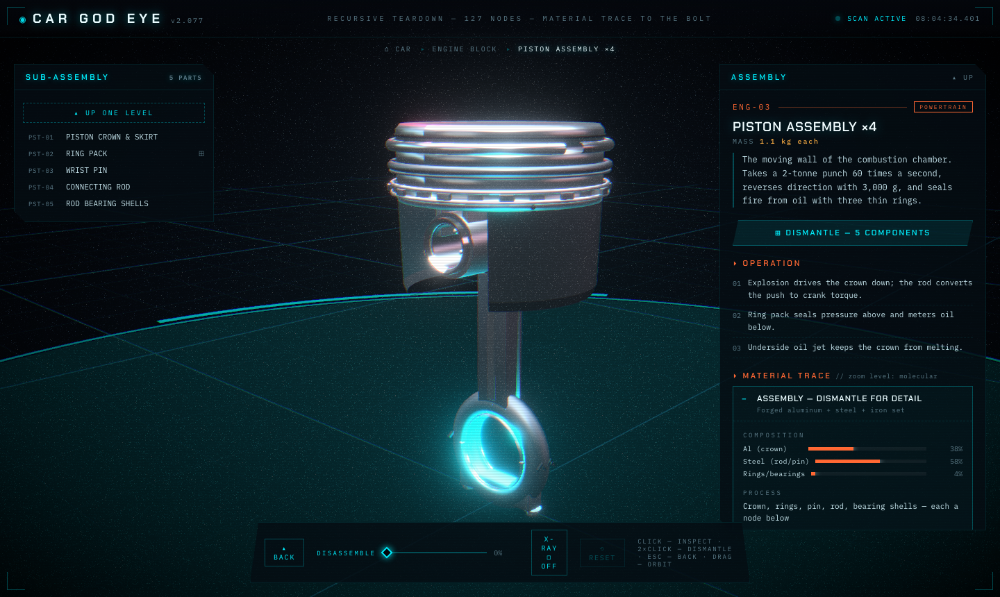 |
| 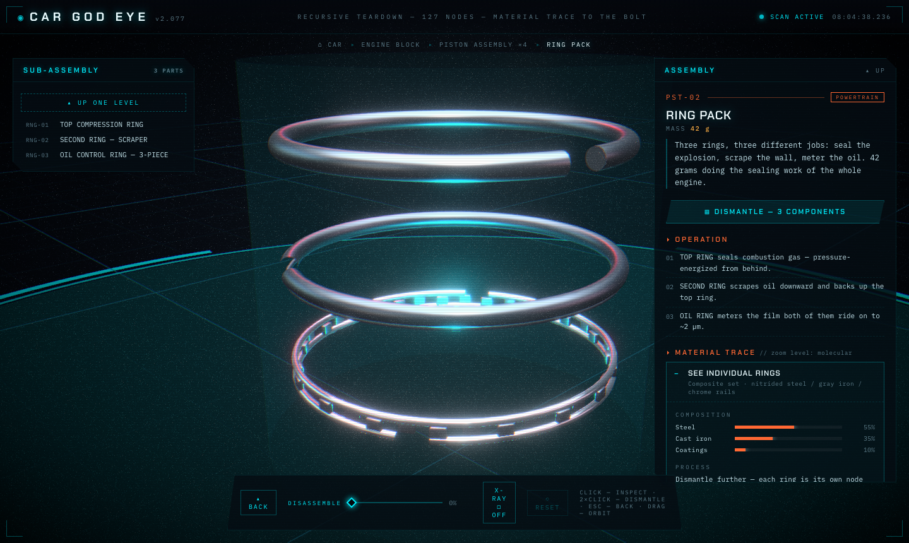 | 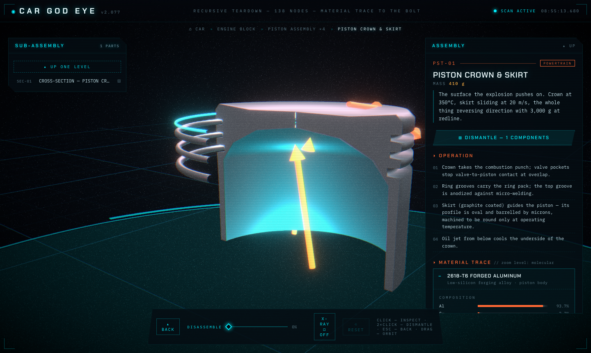 |

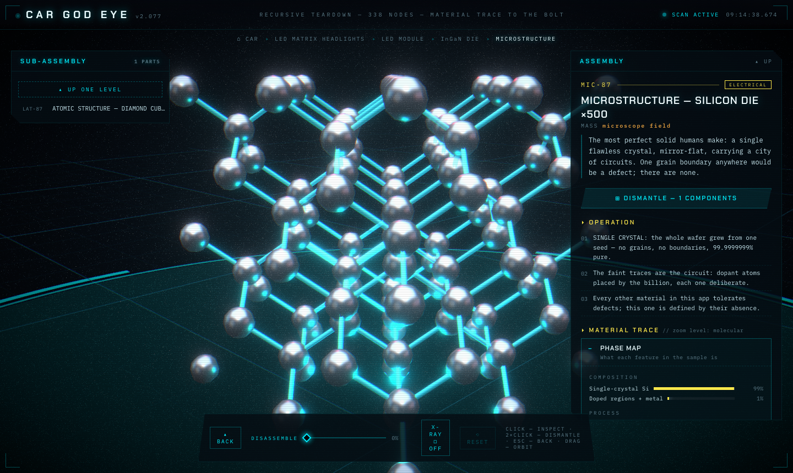

## What it does

- **Recursive dismantling.** Every top-level system opens into its own 3D sub-assembly
  teardown scene. Engine → crank, block, pistons, head, gasket, bolts. Piston → crown,
  ring pack, wrist pin, rod, bearing shells. Ring pack → three individual rings. Same for
  the headlight (→ LED module → InGaN die / phosphor plate / thermal stack), the tire
  (→ tread / steel belts / carcass / bead), the damper (→ rod / shim stack / oil+N₂ /
  seals), the caliper, the diff, the battery, the ECU, the paint stack…
- **Navigate like a file system**: breadcrumb trail, double-click a part to dismantle it,
  `ESC` to go back up, ⊞ buttons in the index, subcomponent links in the detail panel.
- **Every node is a mini encyclopedia entry**: summary, step-by-step OPERATION,
  **MATERIAL TRACE** (elemental composition bars, manufacturing process, *why that material*,
  engineering properties), and fastener specs down to bolt class and torque angle.
- **DISASSEMBLE slider** — exploded view at every level.
- **X-RAY toggle** — ghosts shells and housings to expose internals.
- Camera auto-frames whatever you select (bounding-sphere fit). Hover tags, auto-orbit,
  boot sequence, scanlines, bloom, glitch title.

## Run

```bash
npm install
npm run dev      # http://localhost:5173
npm run build    # production build in dist/
```

## Stack

Vite · React 18 · TypeScript · three.js · @react-three/fiber · drei · postprocessing.
No 3D model files — the entire car is procedural geometry, so every part is a named,
selectable object.

## Structure

```
src/
  data/parts.ts                  ← top-level nodes (the car's 19 systems)
  data/tree-powertrain.ts        ← engine subtree (pistons, rings, head…), turbo, intake…
  data/tree-chassis.ts           ← drivetrain, chassis, suspension+damper, brakes+caliper, wheels+tire
  data/tree-systems.ts           ← radiator, battery, ECU, headlights+LED, body+paint, interior
  data/tree.ts                   ← tree assembly, flat index, pathOf/childrenOf helpers
  scene/lib.tsx                  ← PartGroup (select/hover/dim/explode), materials, helpers
  scene/CarModel.tsx             ← root view: the whole car
  scene/assemblies-*.tsx         ← 26 sub-assembly teardown scenes
  scene/views.ts                 ← node id → 3D view + camera home registry
  scene/CarScene.tsx             ← canvas, camera rig (auto-framing), lights, post FX
  ui/HUD.tsx                     ← breadcrumb, index, node analysis, controls
  state.tsx                      ← tiny external store (path, selection, explode, x-ray)
```

Add a new node: add a `Part` entry (with `children` if it dismantles further) in the right
`data/tree-*.ts`, then give it geometry — a `<PartGroup id="...">` in its parent's view in
`scene/assemblies-*.tsx`, plus a view of its own in `views.ts` if it has children.
